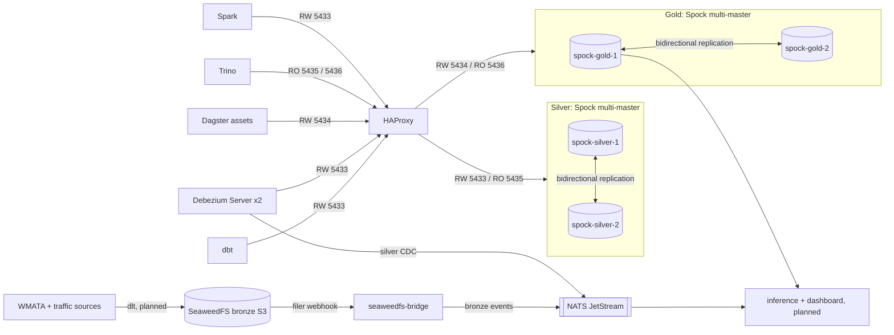

# WMATA Real-Time Lateness Platform

A medallion-architecture data platform for **WMATA** (Washington Metropolitan Area Transit Authority) transit and traffic data. Bronze objects live in **SeaweedFS** (S3), silver and gold tables live in two-node **PostgreSQL + Spock** multi-master clusters, and changes are streamed into **NATS JetStream** through **Debezium** and SeaweedFS filer webhooks. Every database client reaches the silver and gold clusters through **HAProxy**.

> **Status:** infrastructure scaffold. Containers, databases, buckets, streams, CDC wiring, Spock replication and HAProxy routing are in place. dbt models, Dagster assets, dlt pipelines, ML inference and the dashboard are still placeholders — see [Status & Roadmap](#status--roadmap).

---

## Table of Contents

- [Architecture](#architecture)
- [Layer Model](#layer-model)
- [Repository Layout](#repository-layout)
- [Data Flow](#data-flow)
- [NATS JetStream](#nats-jetstream)
- [Debezium CDC](#debezium-cdc)
- [SeaweedFS and the Event Bridge](#seaweedfs-and-the-event-bridge)
- [NATS NUI](#nats-nui)
- [Spark & Trino](#spark--trino)
- [Tech Stack](#tech-stack)
- [Prerequisites](#prerequisites)
- [Setup & Run](#setup--run)
- [Service Ports](#service-ports)
- [Configuration Files](#configuration-files)
- [Smoke Tests](#smoke-tests)
- [Status & Roadmap](#status--roadmap)
- [Known Issues](#known-issues)
- [Troubleshooting](#troubleshooting)

---

## Architecture



The silver and gold layers are each a **two-node Spock active-active cluster**: both nodes accept writes, both hold the full dataset, and there is no sharding or partitioning. Spock replicates changes in both directions. HAProxy is the only network entry point; application containers never resolve `spock-*` hostnames directly.

HAProxy uses **Mode A pinned failover** for write traffic. `balance first` sends every RW connection to node 1 while it is healthy; node 2 is a hot `backup` and takes over automatically when node 1 fails its health check. Pinning batch writers avoids two nodes running the same DDL or bulk load concurrently. Read-only frontends use `balance roundrobin` across both nodes.

| Frontend | Port | Backends | Balance |
|----------|------|----------|---------|
| `silver_rw` | `5433` | `spock-silver-1`, `spock-silver-2` (backup) | `first` |
| `silver_ro` | `5435` | both silver nodes | `roundrobin` |
| `gold_rw` | `5434` | `spock-gold-1`, `spock-gold-2` (backup) | `first` |
| `gold_ro` | `5436` | both gold nodes | `roundrobin` |
| HAProxy stats | `8404` | — | — |

Spock is configured in `configs/spock/init/` (per-node Postgres settings, databases, extensions, `pg_hba.conf`) and `configs/spock/wire/` (one-shot node definitions and bidirectional subscriptions). The wiring job is idempotent and waits for each subscription to reach `replicating`.

**Spock caveats for this stack:**

- Every replicated table needs a primary key or a unique index used as replica identity. Spock does not support standalone `REPLICA IDENTITY FULL`, and `spock.repset_add_all_tables` silently skips tables that lack an index-based identity. dbt models must therefore define a primary key.
- DDL is replicated only when `spock.enable_ddl_replication` and the `ddl_sql` replication set are active. Keep DDL writes on one node at a time (HAProxy Mode A does this) or wrap them with `spock.replicate_ddl`.
- Sequences are not conflict-free across nodes. `snowflake` is installed where available; otherwise use explicit IDs rather than `serial`.
- `UNLOGGED` and `TEMPORARY` tables are not replicated.
- Replication is asynchronous. A conflict is resolved by the configured `last_update_wins` policy; check `spock.resolutions` when investigating divergence.
- Debezium replication slots are node-bound. After an HAProxy failover, the new node may not have the same slot/LSN, so expect to re-snapshot. See [Known Issues](#known-issues).

---

## Layer Model

| Layer | Store | Written by | Read by | Databases / buckets | Schema |
|-------|-------|------------|---------|---------------------|--------|
| **Bronze** | SeaweedFS S3 | dlt (planned) | nobody in dbt/Dagster | `wmata`, `traffic` buckets | n/a |
| **Silver** | Spock cluster `spock-silver-1` + `spock-silver-2` (via `haproxy`) | dbt | Debezium, Dagster, Trino, Spark | `wmata`, `traffic` | `public` |
| **Gold** | Spock cluster `spock-gold-1` + `spock-gold-2` (via `haproxy`) | Dagster assets | dashboard / consumers (planned), Trino | `wmata`, `traffic` | `public` |

The infrastructure database (`postgres-infra`) is separate and remains a single node: it holds `dagster_db` and `mlflow_db`. It is not part of the Spock replication topology.

---

## Repository Layout

```text
.
├── compose.dev.yaml            # All services (dev profile)
├── .env.example                # Environment template
├── dagster/
│   ├── definitions.py          # Definitions + four IO managers (no assets yet)
│   ├── resources/
│   │   └── postgres_io_manager.py
│   ├── etl/Containerfile       # User-code image (dbt, dlt, GX, ML libs)
│   └── daemon/Containerfile    # Webserver + daemon image
├── dbt/
│   ├── dbt_project.yml
│   ├── profiles.yml            # Four targets: silver/gold x wmata/traffic
│   └── models/
│       ├── sources.yml         # Single `silver` source, no fixed database
│       ├── silver/traffic/
│       └── gold/{wmata,traffic}/
├── dlt/
│   └── Containerfile           # Ingestion image only (no pipelines yet)
├── seaweedfs/
│   └── bridge/                 # Filer webhook -> NATS JetStream
│       ├── app.py
│       └── Containerfile
├── spark/
│   ├── Containerfile           # Spark 4.3 + S3A/AWS SDK/Postgres JDBC jars
│   ├── conf/spark-defaults.conf
│   └── jobs/                   # bronze_check.py
├── configs/
│   ├── postgres/               # init-dbs-infra.sh (infra only)
│   ├── spock/init/             # per-node config, databases, extensions, pg_hba
│   ├── spock/wire/             # one-shot node + subscription wiring
│   ├── haproxy/haproxy.cfg     # silver/gold RW+RO frontends
│   ├── seaweedfs/              # s3.json, notification.toml
│   ├── debezium/               # wmata.properties, traffic.properties
│   ├── nui/contexts/           # NATS NUI connection contexts
│   ├── dagster/                # dagster.yaml, workspace.yaml
│   ├── vector/                 # vector.yaml
│   ├── mlflow/                 # Containerfile
│   ├── trino/                  # config + catalog/*.properties
│   └── dashboard.placeholder/  # Caddyfile (not wired to a service yet)
├── monitor/
│   ├── health_monitor.py
│   └── Containerfile
├── shared/
│   ├── alerts.py
│   ├── logging.py
│   └── retry.py
└── storage/                    # gitignored; created at runtime
```

---

## Data Flow

1. **Ingestion (planned).** dlt pipelines write raw objects into the SeaweedFS buckets.
2. **Bronze events.** The SeaweedFS filer emits a webhook for every create/update/delete under the two bronze buckets. `seaweedfs-bridge` maps the object path to a subject and publishes the raw envelope to JetStream.
3. **Silver.** dbt models build the silver tables through HAProxy RW (`haproxy:5433`, one database per domain). Spock replicates each committed change to the other silver node.
4. **Silver CDC.** Two Debezium Server instances tail the silver WAL with `pgoutput` through HAProxy and publish change events to the silver streams.
5. **Gold.** Dagster assets read silver and write gold tables through HAProxy RW (`haproxy:5434`) using the layer-specific IO managers. Spock replicates gold changes to the other gold node.
6. **Consumers (planned).** Inference and dashboard services consume the NATS streams and read gold through HAProxy.

### Event payloads

- **Bronze:** the raw SeaweedFS envelope

  ```json
  {"key": "/buckets/wmata/...", "event_type": "create", "message_data": {...}}
  ```

- **Silver:** Debezium change events on `<domain>.realtime.silver_data.public.<table>`.
- **Inference:** reserved for the lateness inference service (`wmata.realtime.inference`).

---

## NATS JetStream

`nats-init` creates the streams once and owns their retention; Debezium and the bridge only publish.

| Stream | Subjects | Retention | Max bytes |
|--------|----------|-----------|-----------|
| `wmata-bronze` | `wmata.realtime.bronze_data`, `wmata.realtime.bronze_data.>` | 3 days | 2 GB |
| `traffic-bronze` | `traffic.realtime.bronze_data`, `traffic.realtime.bronze_data.>` | 3 days | 2 GB |
| `wmata-silver` | `wmata.realtime.silver_data`, `wmata.realtime.silver_data.>` | 7 days | 5 GB |
| `traffic-silver` | `traffic.realtime.silver_data`, `traffic.realtime.silver_data.>` | 7 days | 5 GB |
| `wmata-inference` | `wmata.realtime.inference`, `wmata.realtime.inference.>` | 7 days | 1 GB |

All streams use file storage, `limits` retention, `discard old`, and a **2 minute duplicate window**. Subject convention:

```text
<domain>.realtime.<layer>_data[.<schema>.<table>]
```

with `domain ∈ {wmata, traffic}` and `layer ∈ {bronze, silver}`.

---

## Debezium CDC

Debezium Server runs **one connector per instance**, so there are two containers.

| Setting | `debezium-wmata` | `debezium-traffic` |
|---------|------------------|--------------------|
| Source | `haproxy:5433` | `haproxy:5433` |
| Database | `wmata` | `traffic` |
| Slot | `wmata_silver` | `traffic_silver` |
| Publication | `wmata_silver_pub` | `traffic_silver_pub` |
| Topic prefix | `wmata.realtime.silver_data` | `traffic.realtime.silver_data` |
| Sink | NATS JetStream | NATS JetStream |

Both use `plugin.name=pgoutput`, `schema.include.list=public`, and `create-stream=false`. The sink subject list must contain **both** the bare prefix and `<prefix>.>` because schema-change events are emitted at the bare prefix.

`table.include.list` is still a placeholder, so every table in the `public` schema is currently captured. Debezium tails the Postgres WAL only; it never reads SeaweedFS.

**Slot failover.** A logical replication slot belongs to one physical node and stores its own LSN. Under normal operation Debezium connects to HAProxy and lands on `spock-silver-1`. If node 1 fails, HAProxy moves the connection to `spock-silver-2`, which does not have that slot. Debezium will either recreate the publication/slot from its saved offset (if the slot exists and the LSN is valid there) or require a reset. The accepted fallback for this dev stack is:

1. Pre-create the same slot and publication on both silver nodes, or
2. Reset the Debezium offset and let it **re-snapshot** the captured tables.

Both behaviours must be verified at runtime; see [Known Issues](#known-issues).

---

## SeaweedFS and the Event Bridge

### Buckets

| Bucket | Purpose | Identity |
|--------|---------|----------|
| `wmata` | Bronze objects for the WMATA domain | `wmata-key-id` |
| `traffic` | Bronze objects for the traffic domain | `traffic-key-id` |
| `mlflow` | MLflow artifacts | `mlflow-key-id` |

Buckets are created by `seaweedfs-init` after the filer is up. Credentials live in `configs/seaweedfs/s3.json` and the S3 gateway listens on `:8333`.

### Notifications

`configs/seaweedfs/notification.toml` configures the filer webhook:

- endpoint `http://seaweedfs-bridge:8080/events`
- event types `create`, `update`, `delete`
- `path_prefixes` limited to `/buckets/wmata/` and `/buckets/traffic/`

SeaweedFS has no native NATS notification target, and the S3 `PutBucketNotificationConfiguration` API is not used. The webhook is the supported path.

### Bridge

`seaweedfs/bridge/app.py` is a small stdlib HTTP server:

- `POST /events` — receives the SeaweedFS envelope, routes by path prefix, publishes to JetStream.
- `GET /health` — liveness probe.

Routing:

```text
/buckets/wmata/...   -> wmata.realtime.bronze_data
/buckets/traffic/... -> traffic.realtime.bronze_data
```

Each publish sets `Nats-Msg-Id` to the SHA-256 of the payload so retries are deduplicated inside the stream's 2 minute window. If NATS is unavailable the bridge returns `503`, which makes SeaweedFS retry with backoff.

---

## NATS NUI

`configs/nui/contexts/` is mounted read-only at `/nui-contexts` and imported at startup via `--nats-cli-contexts`. Imports are persisted in the `/db` volume and are idempotent (matched by import path), so restarting the container does not create duplicates.

| Context file | Connection name | Subject family |
|--------------|-----------------|----------------|
| `wmata-bronze.json` | `wmata-bronze` | `wmata.realtime.bronze_data` |
| `wmata-silver.json` | `wmata-silver` | `wmata.realtime.silver_data` |
| `wmata-inference.json` | `wmata-inference` | `wmata.realtime.inference` |
| `traffic-bronze.json` | `traffic-bronze` | `traffic.realtime.bronze_data` |
| `traffic-silver.json` | `traffic-silver` | `traffic.realtime.silver_data` |

Open <http://localhost:31311> and the connections are already listed.

---

## Spark & Trino

### Apache Spark (standalone)

`spark-master`, `spark-worker` and the one-shot `spark-submit` share one image built from `spark/Containerfile`. The image adds the jars the dev stack needs on top of `apache/spark:4.3.0`:

| Jar | Why |
|-----|-----|
| `hadoop-aws:3.5.0` | S3A filesystem (matches the Hadoop bundled with Spark 4.3) |
| `software.amazon.awssdk:bundle:2.35.4` | AWS SDK v2 used by `hadoop-aws` |
| `postgresql:42.7.14` | JDBC driver for the silver/gold clusters |

`spark/conf/spark-defaults.conf` points S3A at `http://seaweedfs:8333` (path-style, no TLS) and takes credentials from `AWS_ACCESS_KEY_ID` / `AWS_SECRET_ACCESS_KEY`, which compose sets from the `SEAWEEDFS_*` variables. No secrets are stored in the config file.

```bash
# Connectivity check: SeaweedFS over S3A + PostgreSQL over JDBC
docker compose -f compose.dev.yaml --profile dev run --rm spark-submit \
  --master spark://spark-master:7077 /opt/spark/jobs/bronze_check.py

# Run any other job the same way
docker compose -f compose.dev.yaml --profile dev run --rm spark-submit \
  --master spark://spark-master:7077 /opt/spark/jobs/<job>.py
```

Master UI: <http://localhost:8082> · Worker UI: <http://localhost:8083>.

### Trino

Single-node Trino (`trinodb/trino:484`) with one catalog per Postgres database:

| Catalog | Connector target |
|---------|------------------|
| `silver_wmata` | `haproxy:5435/wmata` |
| `silver_traffic` | `haproxy:5435/traffic` |
| `gold_wmata` | `haproxy:5436/wmata` |
| `gold_traffic` | `haproxy:5436/traffic` |

Catalog files use `${ENV:POSTGRES_*_USER}` / `${ENV:POSTGRES_*_PASSWORD}` substitution. They point at the HAProxy read-only frontends, which round-robin both Spock nodes; Trino is meant for ad-hoc SQL and cross-database checks.

```bash
# Interactive CLI
docker compose -f compose.dev.yaml --profile dev exec trino \
  trino --catalog silver_wmata --schema public

# SHOW CATALOGS;
# SHOW TABLES FROM silver_wmata.public;
# SELECT * FROM gold_wmata.public.<table> LIMIT 10;
```

Trino UI: <http://localhost:8080>. Bronze (SeaweedFS) is **not** exposed as a Trino catalog; querying it would require an Iceberg/Hive catalog and a metastore.

---

## Tech Stack

| Area | Technology |
|------|------------|
| Orchestration | Dagster (webserver, daemon, gRPC user code) |
| Transformations | dbt-postgres `1.9.0` |
| Ingestion | dlt (`dlt[postgres]`) |
| Databases (infra) | PostgreSQL `18.4-alpine3.24` (single node) |
| Databases (silver/gold) | pgEdge Postgres `18.7` + Spock `5.0.14`, two-node multi-master per layer |
| Database proxy | HAProxy `3.2-alpine` (RW pinned failover, RO round-robin) |
| Object storage | SeaweedFS `4.53` (S3 gateway + filer) |
| Messaging | NATS `2.15.2-alpine3.22` with JetStream |
| CDC | Debezium Server `3.0.0.Final` |
| Batch compute | Apache Spark `4.3.0` (standalone master + worker) |
| Federated SQL | Trino `484` (one catalog per Postgres database) |
| ML tracking | MLflow `3.14.0` (Postgres backend, SeaweedFS artifacts) |
| Metrics | VictoriaMetrics |
| Logs | VictoriaLogs + Vector |
| Runtime | Python `3.12`, `nats-py==2.16.0` |
| Alerting | Telegram Bot API (optional) |

The Dagster user-code image also installs `great_expectations`, `xgboost`, `scikit-learn`, `pandas`, `numpy`, and `boto3` for the planned modeling work.

---

## Prerequisites

- Docker or Podman with Compose v2 (`docker compose`, not `docker-compose`)
- (Optional) AWS CLI or any S3 client for the smoke tests
- (Optional) Telegram bot token + chat ID for alerts

---

## Setup & Run

### 1. Configure the environment

```bash
cp .env.example .env
```

Environment groups:

| Group | Variables |
|-------|-----------|
| Host binding | `HOST_IP` |
| Databases | `POSTGRES_DB_{INFRA,WMATA,TRAFFIC}`, `POSTGRES_{INFRA,SILVER,GOLD}_{HOST,USER,PASSWORD,PORT,READ_PORT,HOST_PORT}` |
| Retention | `VM_RETENTION`, `VL_RETENTION` |
| SeaweedFS | `SEAWEEDFS_S3_ENDPOINT`, `SEAWEEDFS_ACCESS_KEY`, `SEAWEEDFS_SECRET_KEY`, bucket names, per-domain keys |
| Alerts | `TELEGRAM_BOT_API_KEY`, `TELEGRAM_CHAT_ID` |

Silver and gold clients must use `POSTGRES_SILVER_HOST=haproxy` / `POSTGRES_GOLD_HOST=haproxy` with the RW ports `5433` / `5434`. Read-only consumers use `POSTGRES_*_READ_PORT` (`5435` / `5436`). These are HAProxy ports and are the same inside the compose network and on the host. `postgres-infra` keeps `POSTGRES_INFRA_HOST=postgres-infra` and port `5432`.

### 2. Start services

```bash
docker compose -f compose.dev.yaml --profile dev up -d
```

Startup order is enforced with health and completion checks:

1. `postgres-infra` becomes healthy; all four `spock-*` nodes become healthy (image init scripts configure Spock and create `wmata` + `traffic`).
2. `spock-wire-silver` and `spock-wire-gold` create node definitions and bidirectional subscriptions, then exit.
3. `haproxy` becomes healthy; `db-ready` confirms both RW frontends answer `pg_isready`, then exits.
4. `seaweedfs` becomes healthy, then `seaweedfs-init` creates the buckets.
5. `nats` becomes healthy, then `nats-init` creates the streams.
6. `seaweedfs-bridge` starts after the streams exist.
7. `debezium-*`, `dbt`, `trino` and `spark-submit` wait for `db-ready` and the relevant `spock-wire-*` job.
8. `mlflow` starts after `postgres-infra` and `seaweedfs-init`.

### 3. Verify

```bash
docker compose -f compose.dev.yaml --profile dev ps
```

Wait until infrastructure services report `healthy` and one-shot services report `exited (0)`.

### 4. dbt

```bash
# Parse for a specific target
docker compose -f compose.dev.yaml --profile dev run --rm dbt parse --target silver_wmata

# Build silver for one domain
docker compose -f compose.dev.yaml --profile dev run --rm dbt run --target silver_wmata
```

Available targets: `silver_wmata` (default), `gold_wmata`, `silver_traffic`, `gold_traffic`.

### 5. Trino

```bash
docker compose -f compose.dev.yaml --profile dev exec trino \
  trino --catalog silver_wmata --schema public
```

### 6. Spark

```bash
docker compose -f compose.dev.yaml --profile dev run --rm spark-submit \
  --master spark://spark-master:7077 /opt/spark/jobs/bronze_check.py
```

### 7. Dagster

Open <http://localhost:3000>. `dagster/definitions.py` currently registers four IO managers and **no assets or schedules**.

---

## Service Ports

| Service | Host port | Container port | Notes |
|---------|-----------|----------------|-------|
| `postgres-infra` | `5432` | `5432` | `dagster_db`, `mlflow_db`; single node |
| `haproxy` (silver RW) | `5433` | `5433` | `wmata`, `traffic`; pinned to node 1 |
| `haproxy` (gold RW) | `5434` | `5434` | `wmata`, `traffic`; pinned to node 1 |
| `haproxy` (silver RO) | `5435` | `5435` | Round-robin both silver nodes |
| `haproxy` (gold RO) | `5436` | `5436` | Round-robin both gold nodes |
| `haproxy` (stats) | `8404` | `8404` | Backend health dashboard |
| `seaweedfs` (S3) | `8333` | `8333` | S3 gateway |
| `seaweedfs` (filer) | `8888` | `8888` | Filer HTTP |
| `seaweedfs` (master) | — | `9333` | Internal only |
| `seaweedfs-bridge` | `8081` | `8080` | Webhook receiver |
| `nats` | `4222` | `4222` | Client connections |
| `nats` | `8222` | `8222` | Monitoring HTTP |
| `nats-nui` | `31311` | `31311` | Web GUI |
| `trino` | `8080` | `8080` | Trino UI + `/v1/info` |
| `spark-master` | `7077` | `7077` | Cluster RPC |
| `spark-master` | `8082` | `8080` | Master UI |
| `spark-worker` | `8083` | `8081` | Worker UI |
| `dagster-webserver` | `3000` | `3000` | Dagster UI |
| `mlflow` | `5000` | `5000` | Tracking UI |
| `victoriametrics` | `8428` | `8428` | Metrics HTTP |
| `victorialogs` | `9428` | `9428` | Logs HTTP |
| `debezium-*` | — | `8080` | Health endpoint, internal only |
| `vector` | — | — | No exposed port |

All host ports bind to `${HOST_IP:-127.0.0.1}`.

---

## Configuration Files

| Path | Purpose |
|------|---------|
| `configs/postgres/init-dbs-infra.sh` | Creates `dagster_db` + `mlflow_db` |
| `configs/spock/init/*.sh` | Per-node Postgres/Spock config, databases, extensions, `pg_hba.conf` |
| `configs/spock/wire/run.sh` | Idempotent Spock node definitions and bidirectional subscriptions |
| `configs/haproxy/haproxy.cfg` | Silver/gold RW+RO frontends and stats |
| `configs/seaweedfs/s3.json` | S3 identities and credentials |
| `configs/seaweedfs/notification.toml` | Filer webhook target, filters, retry policy |
| `configs/debezium/wmata.properties` | Silver CDC for the `wmata` database |
| `configs/debezium/traffic.properties` | Silver CDC for the `traffic` database |
| `configs/nui/contexts/*.json` | NUI connections imported at startup |
| `configs/dagster/dagster.yaml` | Dagster storage + scheduler |
| `configs/dagster/workspace.yaml` | gRPC user-code location |
| `configs/vector/vector.yaml` | Container log collection |
| `configs/mlflow/Containerfile` | MLflow image with Postgres + S3 drivers |
| `configs/trino/*` | Trino config + one Postgres catalog per database |
| `spark/Containerfile` | Spark image with S3A + JDBC jars |
| `spark/conf/spark-defaults.conf` | S3A endpoint/credentials provider, shuffle |
| `spark/jobs/*` | Spark jobs (example: `bronze_check.py`) |
| `configs/dashboard.placeholder/Caddyfile` | Reverse-proxy plan (no service yet) |

---

## Smoke Tests

```bash
# 1. Streams exist
docker compose -f compose.dev.yaml --profile dev \
  run --rm --entrypoint nats nats-init -s nats:4222 stream ls

# 2. NATS NUI imported the contexts
docker compose -f compose.dev.yaml --profile dev logs nats-nui | grep -i 'imported connection'

# 3. Upload an object and watch the bronze stream
echo '{"test":1}' > /tmp/sample.json
AWS_ACCESS_KEY_ID=wmata-key-id AWS_SECRET_ACCESS_KEY=wmata-secret-key \
  aws --endpoint-url http://localhost:8333 s3 cp /tmp/sample.json s3://wmata/sample.json
docker compose -f compose.dev.yaml --profile dev \
  run --rm --entrypoint nats nats-init -s nats:4222 sub 'wmata.realtime.bronze_data.>'

# 4. Debezium readiness
docker compose -f compose.dev.yaml --profile dev \
  exec debezium-wmata curl -sf http://localhost:8080/q/health/ready

# 5. dbt project parses
docker compose -f compose.dev.yaml --profile dev run --rm dbt parse --target silver_wmata

# 6. Trino lists its catalogs
docker compose -f compose.dev.yaml --profile dev exec trino trino --execute 'SHOW CATALOGS'

# 7. Spark reaches SeaweedFS (S3A) and Postgres (JDBC via HAProxy)
docker compose -f compose.dev.yaml --profile dev run --rm spark-submit \
  --master spark://spark-master:7077 /opt/spark/jobs/bronze_check.py

# 8. HAProxy sees both backends on each cluster
curl -s http://localhost:8404/ | grep -E 'spock-(silver|gold)-[12]'

# 9. Spock nodes and subscriptions are replicating
docker compose -f compose.dev.yaml --profile dev exec spock-silver-1 \
  psql -U postgres -d wmata -c 'SELECT * FROM spock.node;' \
  -c 'SELECT subscription_name, status FROM spock.sub_show_status();'

# 10. Writes replicate in both directions (run on node 1, read on node 2)
docker compose -f compose.dev.yaml --profile dev exec spock-silver-1 \
  psql -U postgres -d wmata -c \
  'CREATE TABLE IF NOT EXISTS public.spock_probe (id int PRIMARY KEY, note text);
   INSERT INTO public.spock_probe VALUES (1, $$from-node-1$$)
   ON CONFLICT (id) DO UPDATE SET note = EXCLUDED.note;'
docker compose -f compose.dev.yaml --profile dev exec spock-silver-2 \
  psql -U postgres -d wmata -c 'TABLE public.spock_probe;'
```

Step 3 requires the AWS CLI (or any S3 client). Deleting the object should also appear on the stream as a `delete` event.

---

## Status & Roadmap

| Area | State |
|------|-------|
| Compose infrastructure (Spock silver x2, Spock gold x2, postgres-infra, SeaweedFS, NATS, Debezium x2, MLflow, VictoriaMetrics, VictoriaLogs) | Implemented |
| Spock multi-master bootstrap (`configs/spock/init`) | Implemented |
| Spock bidirectional wiring (`spock-wire-silver`, `spock-wire-gold`) | Implemented; runtime validation pending |
| HAProxy RW/RO routing and stats | Implemented; failover validation pending |
| Bucket bootstrap (`seaweedfs-init`) | Implemented |
| Stream bootstrap (`nats-init`) | Implemented |
| Bronze webhook bridge | Implemented |
| NUI context import | Implemented |
| Spark standalone cluster (`spark-master`, `spark-worker`, `spark-submit`) | Implemented (example job included) |
| Trino catalogs over silver/gold Postgres | Implemented |
| Silver CDC configuration | Configured; needs real silver tables |
| dbt models | Placeholder (`.gitkeep` only, `sources.yml` has `PLACEHOLDER_TABLE`) |
| Dagster assets, jobs, schedules | Placeholder (`assets=[]`, no schedules) |
| dlt pipelines | Placeholder (image only) |
| ML training / MLflow experiments | Not started |
| Inference service | Commented out in `compose.dev.yaml` |
| Dashboard backend / frontend | Commented out; source not present |
| Great Expectations suites | Library installed, no suites |
| Health monitor | Code present, service commented out |
| Caddy reverse proxy | Config placeholder, no service |

---

## Known Issues

- Spock requires an index-based replica identity (primary key or unique index) for `UPDATE`/`DELETE` replication. Tables created by dbt without a PK are skipped by `spock.repset_add_all_tables` and will diverge. Always define a primary key in dbt models.
- Spock does not support `REPLICA IDENTITY FULL` on its own; do not rely on it for keyless tables.
- dbt table materializations use `CREATE TABLE AS`. Whether the initial rows replicate depends on Spock's DDL handling and must be verified. If they do not, switch the model to `incremental`/`append` so the data load is a replicated `INSERT`. This test is still pending.
- Debezium logical replication slots are node-bound. Under HAProxy Mode A a failover to node 2 can lose the slot or its LSN. The fallback is a pre-created slot on both nodes or a Debezium re-snapshot. This test is still pending.
- Spock replication is asynchronous and conflict resolution is `last_update_wins`; concurrent writes to the same row on both nodes can lose an update. HAProxy Mode A reduces this by pinning batch writers to node 1.
- DDL should be applied on one node at a time. HAProxy Mode A pins RW traffic, but manual `psql` sessions that bypass HAProxy can still race.
- Sequences are not cluster-safe; `snowflake` is installed only if the image provides it. Prefer explicit IDs over `serial`.
- `postgres-infra` is a single node with no replication; it is not covered by Spock.
- `dbt/models/silver/wmata/` does not exist yet (only `silver/traffic/`).
- `dbt_project.yml` declares `macro-paths: ["macros"]`, but `dbt/macros/` is missing.
- `dbt/models/sources.yml` still references `PLACEHOLDER_TABLE`.
- Debezium has no `table.include.list`, so all `public` tables are captured; add one before production use.
- `seaweedfs-init` ends each `weed shell` call with `|| true`, so a failed bucket creation can pass silently. Check the logs and the bucket list.
- The SeaweedFS master UI on `9333` is not published to the host.
- There is no authentication or TLS on NATS, SeaweedFS, or the databases. This stack is for local development only.
- `monitor`, `inference`, `dashboard-*`, `dlt-*`, and `dbt` run only when invoked explicitly; the `dbt` service is a one-shot task, not a long-running service.
- Trino has no catalog for bronze; querying SeaweedFS requires an Iceberg/Hive catalog plus a metastore.
- The Spark image downloads `hadoop-aws`, the AWS SDK bundle and the JDBC driver from Maven Central at build time, so the first `build` needs network access and is large (~500 MB).
- Spark executors inherit `AWS_ACCESS_KEY_ID` / `AWS_SECRET_ACCESS_KEY` from `spark-worker`; rotating the SeaweedFS keys means recreating the Spark containers.
- `spark-submit` is a one-shot task (like `dbt`); use `docker compose run --rm` rather than `up`.

---

## Troubleshooting

| Symptom | Cause / fix |
|---------|-------------|
| `nats` container restarts or is unhealthy | Use the `-alpine3.22` tag; the scratch image has no shell or `wget` for the healthcheck. |
| SeaweedFS healthcheck fails | `-ip.bind=0.0.0.0` must be set so `127.0.0.1:9333` responds inside the container. |
| `seaweedfs-bridge` returns `503` | NATS is down or the stream does not exist yet; check `nats-init` logs. |
| Debezium cannot write offsets | The dev service runs as `user: "0"` so the `storage/debezium/*` bind mounts are writable. |
| Need to reset CDC state | Stop the stack, remove `storage/debezium/*`, and drop the replication slots/publications on both silver nodes. |
| Spock subscription is `down` or `initializing` | Check `spock.sub_show_status()`; inspect `docker compose logs spock-wire-silver` and the node logs. Verify `PGEDGE_USER`/`PGEDGE_PASSWORD` match on every node. |
| Spock table is missing or diverged | The table likely lacks a primary key/unique index; add one, then re-run the wiring job or call `spock.repset_add_all_tables`. |
| HAProxy marks a backend `DOWN` | Check `http://localhost:8404/`; verify the node healthcheck (`pg_isready`) and that both databases exist. |
| `db-ready` never completes | HAProxy cannot reach the RW backend; inspect `docker compose logs haproxy` and the Spock node health. |
| Need a clean slate | `docker compose --profile dev down -v` removes the named Spock volumes. Deleting `storage/` resets the bind-mounted Debezium/SeaweedFS state. |
| dbt connects to the wrong port | Use `POSTGRES_*_HOST=haproxy` and `POSTGRES_*_PORT=5433`/`5434`. `POSTGRES_*_READ_PORT` is only for read-only consumers. |
| Trino stays unhealthy | Catalogs fail if the `POSTGRES_*` env vars are missing; check `docker compose logs trino` for `${ENV:...}` resolution errors. |
| Spark worker never registers | It waits for the `spark-master` healthcheck on port `8080`; check the master UI at <http://localhost:8082>. |
| Spark job cannot read `s3a://` | `AWS_ACCESS_KEY_ID`/`AWS_SECRET_ACCESS_KEY` must be set on `spark-worker` and `spark-submit`, and `fs.s3a.endpoint` must point at `seaweedfs:8333`. |
